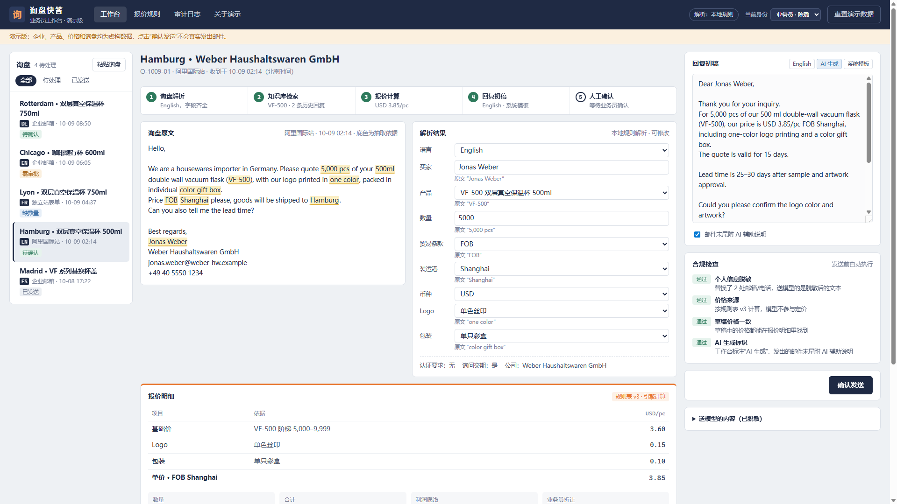
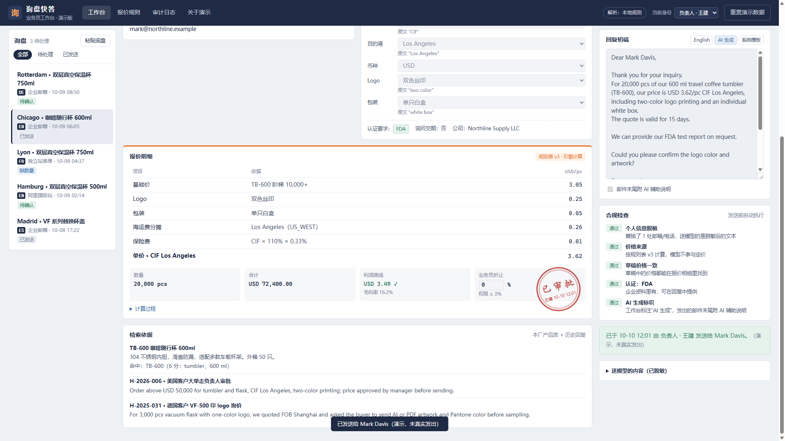
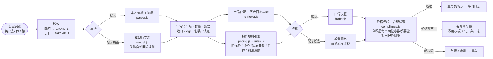

# 询盘快答（演示版）

**外贸工厂业务员的询盘回复台：买家询盘进来，系统拆字段、查产品、按规则算价、用买家的语言写初稿；价格永远由规则表算，模型只负责读懂和措辞，超权限的报价必须负责人审批。**

给外贸中小工厂业务员用的询盘回复和报价工作台。一封买家询盘进来，系统先把需求拆成字段，查本厂产品，按企业自己的报价规则算出价格，再用买家的语言写好回复初稿；业务员看过依据、确认之后才发出去。超出权限的报价要负责人审批。

这是江苏省 OPC 创新创业大赛（创新赛道 · AI+出海）参赛项目的可运行演示，用来说明方案能落地。它不是上线产品。

| 工作台：原文高亮 + 报价明细 + 多语种初稿 | 负责人审批后盖章 |
| --- | --- |
|  |  |

<!-- TODO: 可补一张"模型擅自改价被拦截"的截图（审计日志里那条记录），这是最能说明设计的画面。 -->

## 架构

浏览器和服务端共用同一份五步流水线（`src/core/pipeline.js`）。模型是可选的，而且被夹在两道确定性检查之间。



## 我在这个项目里解决的落地难点

1. **模型不能碰价格，而且要能证明它没碰。** 价格只从 `pricing.js` + 规则表出，同样输入永远同样结果，每一行能对回规则表。模型写初稿时拿到的是算好的价格并被要求原样照抄；返回后再过一遍校验：草稿里凡是两位小数的数字都必须能在报价明细里找到，单价不能漏，否则整稿丢弃、回退模板并写审计日志。服务端测试专门起一个"会擅自改价"的假模型来验证这条拦截。

2. **不猜缺失信息。** 买家没写数量（Lyon 那封），系统不补一个默认值，而是按四档数量各算一个参考价，并在买家语言的回复里追问。缺字段进入 `missing`，由业务员补或由回复去问，不由模型填。

3. **审批是流程不是提示。** 折让超 3%、单价低于利润底线、订单超 5 万美元、贸易条款不支持、受限地区、草稿价格和明细对不上——任一命中就只能"提交负责人审批"，按钮层面就发不出去；批准后报价单盖章，审计日志记录规则表版本、每项价格来源和确认人。

4. **离线可演示，上线可合规。** 默认不连模型，询盘不离开本机；配置的是国产备案模型的 OpenAI 兼容接口，送出去的文本先脱敏。模型调用失败自动回退，演示不会因为网络中断。

5. **把"哪些是真的、哪些是编的"写在 README 第一节。** 参赛 demo 最容易被质疑的就是数据和用户数。这里直接声明：流程是真的，数据是编的，没有客户、没有营收，评测集是自己写的、样本少、接近满分不代表真实表现。

## 先说清楚：哪些是真的，哪些是编的

- 流程是真的。解析、检索、算价、写初稿、合规检查、审批和审计日志都是实际运行的代码，你可以粘贴自己的询盘试。
- 数据是编的。企业（苏州恒川日用制品）、四款产品、成本、阶梯价、历史回复、五封示例询盘和里面的人名、邮箱、电话，全部是虚构的，不对应任何真实工厂或买家。
- 不会发邮件。“确认发送”只把记录写进审计日志。
- 默认不连模型。没配模型接口时，询盘由本地规则解析，初稿用系统模板，询盘内容不会离开你的电脑。配置国产备案模型后，解析和措辞交给模型，价格仍由规则引擎计算（见下文“接入模型”）。
- 目前没有客户、没有试点、没有营收。评测数字来自自己编写的询盘，只能说明代码在这些写法上的表现。

## 运行

需要 Node.js 18 或更高版本，没有其他依赖，不用 `npm install`。

```bash
npm start
```

浏览器打开 <http://localhost:5173>。演示数据存在浏览器本地，右上角“重置演示数据”可以恢复初始状态。

也可以不启动服务，直接把仓库发布到 GitHub Pages（仓库 Settings → Pages → 选择 main 分支根目录）。静态托管下只有本地规则模式，其余功能都能用，适合填到报名表的“产品体验链接”里。

## 三分钟演示怎么走

1. **Hamburg**（英语）：信息齐全。看原文里的高亮（每个字段从哪句话抽出来的）、右边的报价明细（3.60 + 0.15 + 0.10 = USD 3.85，FOB Shanghai），初稿直接确认发送。
2. **Lyon**（法语）：买家没写数量，要欧元报价。系统不猜数量，按四档数量各算一个欧元参考价，在法语回复里一并追问。
3. **Chicago**（英语）：两万只，合计 USD 72,400，超过 5 万美元。业务员只能“提交负责人审批”；右上角切到“负责人”，批准后报价单上会盖章。
4. **Rotterdam**（德语）：买家要 BSCI 验厂报告，企业资料里没有。草稿写的是“负责人另行回复”，不作承诺，合规检查给出提示。
5. 随便挑一封，把折让改成 5%，或者直接在草稿里改价格，看系统怎么拦。
6. 打开“审计日志”，每次发送都记录了规则表版本、每一项价格的来源和确认人。

“粘贴询盘”里另有三个例子：低于起订量、DDP 条款（不自动报价）、受限地区（转人工复核）。


## 价格是怎么算的

价格只由 `src/core/pricing.js` 和规则表 `src/data/rules.js` 算出来，模型不参与。同样的输入永远得到同样的结果，每一行都能对回规则表。

以 Hamburg 那封为例：

| 项目 | 依据 | USD/只 |
| --- | --- | --- |
| 基础价 | VF-500，5,000–9,999 只档 | 3.60 |
| Logo | 单色丝印 | 0.15 |
| 包装 | 单只彩盒 | 0.10 |
| 单价 | FOB Shanghai | 3.85 |

同时做底线校验：单只成本 20.5 元 ÷ 7.1 + 丝印成本 0.10 + 彩盒成本 0.07 = USD 3.057，乘以 (1 + 15%) 得到利润底线 USD 3.52。报价高于底线，可以直接发。

规则表目前支持：数量阶梯、logo 和包装加价、FOB / EXW / CFR / CIF（按目的港分摊海运费，CIF 按 110% 投保）、美元或欧元报价（欧元加 2% 汇率缓冲）、起订量。DDP、DAP 不自动报价。

以下情况必须负责人审批：业务员折让超过 3%、单价低于利润底线、订单金额超过 USD 50,000、贸易条款不在支持范围、询盘涉及受限地区、草稿里的价格和报价明细对不上（这种情况直接禁止发送）。

## 模型能做什么，不能做什么

模型只做两件事：读懂询盘（抽字段），以及把初稿写得更自然。为了不让它碰价格，有三道限制：

1. 送给模型的是脱敏文本，邮箱和电话先换成 `[EMAIL_1]`、`[PHONE_1]`。工作台右下角能看到实际发出去的内容。
2. 写初稿时，模型拿到的是规则引擎已经算好的价格，要求原样照抄。
3. 模型返回的初稿要过一遍价格校验：凡是带两位小数的数字，都必须能在报价明细里找到，单价也不能漏。不通过就丢弃，改用系统模板，审计日志里记一条。

## 接入模型

复制 `.env.example` 为 `.env`，填入接口地址、模型名和 Key，然后 `npm start`。接口需要兼容 OpenAI Chat Completions 格式，示例里列了 DeepSeek、通义千问兼容模式和智谱 GLM 的地址。只接已备案的国产模型；如果面向公众提供服务，还要按规定办理登记或备案。

```env
LLM_BASE_URL=https://api.deepseek.com
LLM_MODEL=deepseek-chat
LLM_API_KEY=你的 Key
```

启动后右上角会显示“解析：模型 deepseek-chat”。模型调用失败时自动退回本地规则，演示不会中断。

## 测试和评测

```bash
npm test       # 41 个用例：报价引擎、解析器、初稿与价格校验、脱敏、服务端接口
npm run eval   # 在 12 封虚构询盘上统计准确率，结果写入 docs/eval-report.md
```

服务端测试会起一个本地假模型，验证“模型擅自改价或漏写单价会被拦截”。

最近一次评测结果见 [docs/eval-report.md](docs/eval-report.md)。评测集是自己写的，样本少，覆盖的写法有限，所以接近满分并不说明真实询盘上也能做到。真实准确率要等企业授权、脱敏后用真实询盘测。人工修改率和首次回复耗时需要真实使用记录，现在统计不了。

## 目录

```text
index.html, styles.css     页面
src/app.js                 工作台交互、审批、审计日志（浏览器端）
src/core/parser.js         本地解析：语言、产品、数量、条款、港口、logo、包装、认证、签名
src/core/retriever.js      产品匹配和历史回复检索
src/core/pricing.js        报价规则引擎和草稿价格校验
src/core/drafter.js        英、法、西、德四种语言的回复模板
src/core/compliance.js     脱敏和合规检查
src/core/pipeline.js       把以上五步串起来，浏览器和服务端共用
src/core/model.js          模型提示词、字段归一化、合并
src/data/                  虚构的企业资料、规则表、示例询盘
server.mjs                 本地服务，可选的模型接口
test/                      node:test 用例
scripts/                   评测脚本和评测集
```

## 已知局限

- 本地解析器是规则加词表，只认英、法、西、德四种语言和常见写法，换个说法就可能漏。接入模型后会好很多，但还没在真实询盘上验证。
- 汇率、运费是规则表里的固定值，没有接实时数据。
- 没有接邮箱、阿里国际站或企业微信，询盘靠手动粘贴。
- 受限地区只是一个关键词列表，正式使用要对接企业自己的出口管制筛查。
- 数据存在浏览器 localStorage 里，换浏览器或清缓存就没了；没有账号体系，身份切换只是为了演示审批流程。

## 接下来

| 时间 | 计划 |
| --- | --- |
| 10-16 至 10-29 | 接入国产备案模型，扩充评测集，录制 3 分钟演示视频 |
| 10-30 至 11-08 | 联系 3 到 5 家南京、苏南外贸工厂访谈；经授权用脱敏样例试跑 |
| 11-09 至 11-10 | 复赛补充演示视频、测试记录和访谈反馈 |

以上是计划，不是已完成的事项。

## 联系

项目负责人：【负责人姓名】 · 【手机 / 邮箱】
